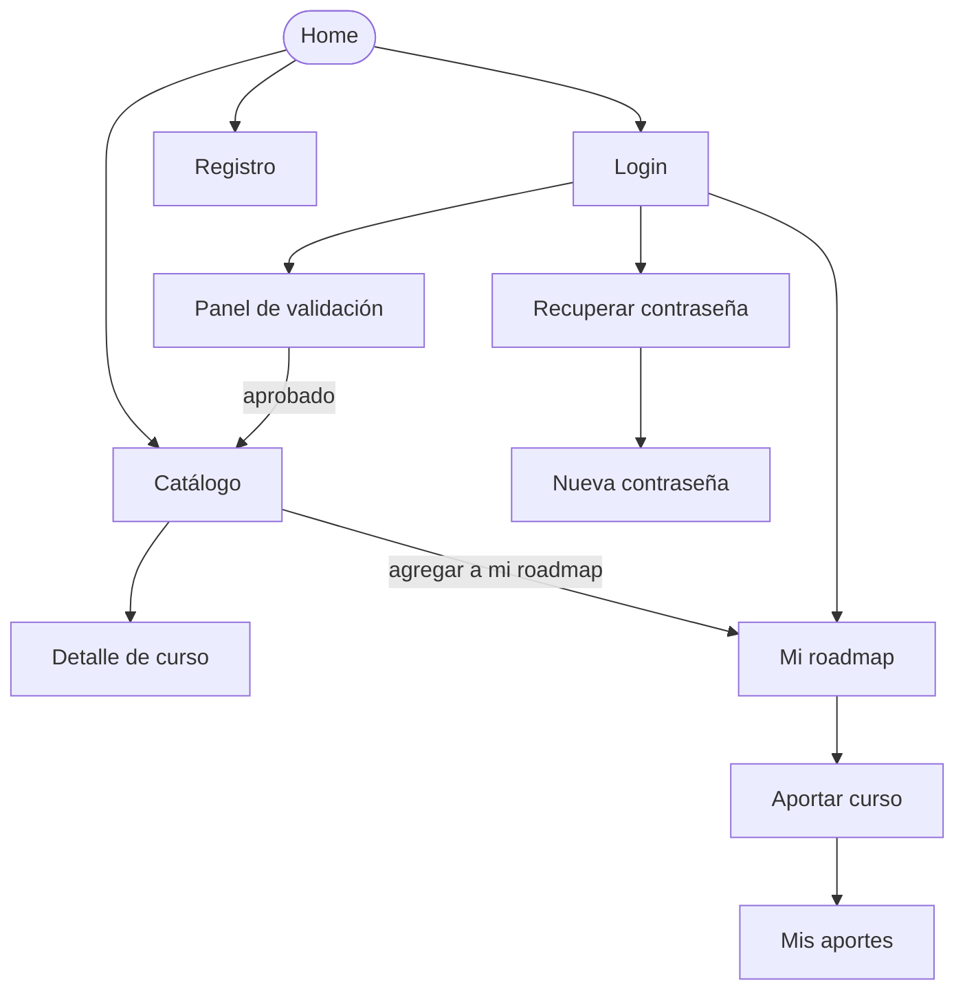

# APPFlow — Mapa del sitio y flujos de usuario — Brújula

## 1. Sitemap

## 2. Rutas

| Ruta | Pantalla | Requiere login | Notas |
|------|----------|----------------|-------|
| `/` | Home | no | presenta el producto y un acceso al catálogo |
| `/catalogo` | Catálogo comunitario (paginado) | no | filtros: texto `q` y categoría |
| `/catalogo/:id` | Detalle de curso | no | solo cursos publicados |
| `/registro` | Registro | no | |
| `/login` | Login | no | |
| `/recuperar` | Pedir recuperación de contraseña | no | |
| `/restablecer` | Nueva contraseña | no | recibe el token por query string |
| `/aportar` | Formulario de aporte | sí | redirect a `/login` si no hay sesión |
| `/mis-aportes` | Estado de mis aportes | sí | |
| `/roadmap` | Mi roadmap | sí | redirect a `/login` si no hay sesión |
| `/validar` | Panel de validación | sí (rol validador) | un usuario común recibe 403 |

## 3. Fichas de pantalla

### Home (`/`)

- **Objetivo del usuario:** entender qué es Brújula y llegar al catálogo.
- **Componentes:** header con menú sándwich, texto de presentación, botón "Ver catálogo".
- **Estados:** `ok`.
- **APIs que consume:** ninguna.
- **Navegación:** hacia `/catalogo`, `/login`, `/registro`.

### Catálogo comunitario (`/catalogo`)

- **Objetivo del usuario:** descubrir cursos validados buscando por texto o categoría.
- **Componentes:** header, buscador, selector de categoría, grid de cards, paginador, empty state, skeleton.
- **Estados:** `loading` (skeleton) · `ok` · `empty` (sin resultados) · `error` (con reintentar).
- **APIs que consume:** `GET /api/v1/cursos?page=&page_size=&categoria=&q=` y `GET /api/v1/categorias` (BackendSchema §3.2 y §3.5).
- **Navegación:** hacia el detalle de un curso; "Agregar a mi roadmap" desde cada card.

### Detalle de curso (`/catalogo/:id`)

- **Objetivo del usuario:** ver todos los datos de un curso para decidir si le sirve.
- **Componentes:** header, ficha con todos los datos, botón "Agregar a mi roadmap", enlace al curso original.
- **Estados:** `loading` · `ok` · `error 404`.
- **APIs que consume:** `GET /api/v1/cursos/{id}`; `POST /api/v1/roadmap/items` (BackendSchema §3.2 y §3.4).
- **Navegación:** vuelve a `/catalogo`; va a `/roadmap` tras agregar.

### Registro (`/registro`)

- **Objetivo del usuario:** crear una cuenta.
- **Componentes:** formulario (nombre, email, contraseña), botón de envío, errores junto al campo.
- **Estados:** `ok` · `loading` · `error` (email duplicado, validación).
- **APIs que consume:** `POST /api/v1/auth/registro` (BackendSchema §3.1).
- **Navegación:** tras registrarse va a `/login`.

### Login (`/login`)

- **Objetivo del usuario:** iniciar sesión.
- **Componentes:** formulario (email, contraseña), enlace "Olvidé mi contraseña", mensajes de error.
- **Estados:** `ok` · `loading` · `error` (credenciales, demasiados intentos).
- **APIs que consume:** `POST /api/v1/auth/login` y `GET /api/v1/auth/me` (BackendSchema §3.1).
- **Navegación:** vuelve a la ruta original o va a `/roadmap`; hacia `/recuperar`.

### Recuperar contraseña (`/recuperar`)

- **Objetivo del usuario:** pedir un enlace para cambiar la contraseña.
- **Componentes:** campo de email, botón, mensaje de confirmación.
- **Estados:** `ok` · `loading` · `enviado` (mensaje neutro, exista o no el email).
- **APIs que consume:** `POST /api/v1/auth/recuperar` (BackendSchema §3.1).
- **Navegación:** vuelve a `/login`.

### Nueva contraseña (`/restablecer`)

- **Objetivo del usuario:** definir una contraseña nueva con el token recibido.
- **Componentes:** campo de contraseña nueva, botón, errores.
- **Estados:** `ok` · `loading` · `error` (token inválido, vencido o usado).
- **APIs que consume:** `POST /api/v1/auth/restablecer` (BackendSchema §3.1).
- **Navegación:** tras el éxito va a `/login`.

### Aportar curso (`/aportar`)

- **Objetivo del usuario:** cargar un curso gratuito para que lo valide la comunidad.
- **Componentes:** formulario con todos los metadatos de la SPEC, selector de categoría, casilla "yo tomé este curso", errores inline.
- **Estados:** `ok` · `loading` · `error` (validación, URL duplicada, red).
- **APIs que consume:** `GET /api/v1/categorias`; `POST /api/v1/aportes` (BackendSchema §3.5 y §3.3).
- **Navegación:** tras enviar va a `/mis-aportes`.

### Mis aportes (`/mis-aportes`)

- **Objetivo del usuario:** saber si sus aportes fueron aprobados o rechazados.
- **Componentes:** lista paginada con estado y motivo de rechazo, paginador, empty state con enlace a `/aportar`.
- **Estados:** `loading` · `ok` · `empty` · `error`.
- **APIs que consume:** `GET /api/v1/aportes/mios` (BackendSchema §3.3).
- **Navegación:** hacia `/aportar`.

### Mi roadmap (`/roadmap`)

- **Objetivo del usuario:** ver sus cursos y marcar su avance.
- **Componentes:** lista paginada de cursos, selector de estado por curso, botón "Quitar", paginador, empty state con enlace a `/catalogo`.
- **Estados:** `loading` · `ok` · `empty` · `error`.
- **APIs que consume:** `GET /api/v1/roadmap`; `PATCH /api/v1/roadmap/items/{id}`; `DELETE /api/v1/roadmap/items/{id}` (BackendSchema §3.4).
- **Navegación:** hacia `/catalogo` y `/catalogo/:id`.

### Panel de validación (`/validar`)

- **Objetivo del usuario:** revisar aportes pendientes y resolverlos.
- **Componentes:** lista paginada de aportes en revisión, botones "Aprobar" y "Rechazar", modal para el motivo de rechazo, paginador, empty state.
- **Estados:** `loading` · `ok` · `empty` · `error` · `403` (si no es validador).
- **APIs que consume:** `GET /api/v1/aportes/pendientes`; `POST /api/v1/aportes/{id}/aprobar`; `POST /api/v1/aportes/{id}/rechazar` (BackendSchema §3.3).
- **Navegación:** hacia `/catalogo`.

## 4. Flujos de usuario

### Flujo 1 — Aportar un curso al catálogo

1. Usuario con sesión elige "Aportar curso" en el menú.
2. Llega a `/aportar`, que carga las categorías (`GET /categorias`).
3. Completa URL, categoría, tema, título, versión, año, docentes, cuestionarios, examen, certificado, aval y "yo tomé este curso".
4. Validaciones en línea: campos obligatorios y formato de URL.
5. Envía: `POST /api/v1/aportes` responde 201 con estado `en_revision`.
6. Aparece un toast de confirmación y va a `/mis-aportes`.
7. **Ramas de error:** validación fallida (422) muestra errores junto al campo sin perder lo escrito; URL duplicada (409) muestra un mensaje claro; error de red muestra un toast con reintento.

### Flujo 2 — Descubrir un curso y agregarlo a mi roadmap

1. Visitante o usuario entra a `/catalogo`; se cargan los cursos y las categorías.
2. Busca por texto o filtra por categoría y la lista se actualiza.
3. Abre el detalle (`/catalogo/:id`).
4. Presiona "Agregar a mi roadmap".
5. **Sin sesión:** va a `/login` y, al ingresar, vuelve al curso.
6. **Con sesión:** `POST /api/v1/roadmap/items` responde 201 y aparece un toast.
7. En `/roadmap` cambia el estado con `PATCH` (pendiente, en curso, completado).
8. **Ramas de error:** curso ya incluido (409) muestra "ya está en tu roadmap"; curso no publicado (404) muestra error.

### Flujo 3 — Validación de un aporte

1. Un validador entra a `/validar` y se listan los aportes (`GET /aportes/pendientes`).
2. Revisa los datos y el enlace del curso.
3. **Aprobar:** `POST /aportes/{id}/aprobar` responde 200; el curso pasa a `publicado` y sale de la lista.
4. **Rechazar:** se abre un modal pidiendo el motivo; `POST /aportes/{id}/rechazar` responde 200 y el curso pasa a `rechazado`.
5. **Ramas de error:** no es validador (403) redirige a `/`; es su propio aporte (403) muestra un mensaje; ya resuelto (409) muestra aviso y actualiza la lista; falta el motivo (422) marca el campo.

### Flujo 4 — Registro y recuperación de contraseña

1. Persona nueva entra a `/registro` y envía sus datos (`POST /auth/registro`).
2. Va a `/login`, inicia sesión (`POST /auth/login`) y accede al sitio.
3. Si olvidó la contraseña, en `/recuperar` envía su email (`POST /auth/recuperar`) y ve un mensaje neutro.
4. Abre el enlace con token (`/restablecer?token=…`) y define una contraseña nueva (`POST /auth/restablecer`).
5. **Ramas de error:** token vencido, inválido o usado (400) muestra un error con enlace para pedir otro; demasiados intentos de login (429) muestra el tiempo de espera.

## 5. Estados globales de la app

| Situación | Comportamiento |
|-----------|----------------|
| Sin sesión y ruta protegida | redirect a `/login` con retorno a la ruta original |
| Sesión expirada (401) | se borra la sesión, aparece un toast y se redirige a `/login` |
| Rol insuficiente (403) | redirect a `/` con un mensaje |
| Error de red global | banner con botón "Reintentar" |