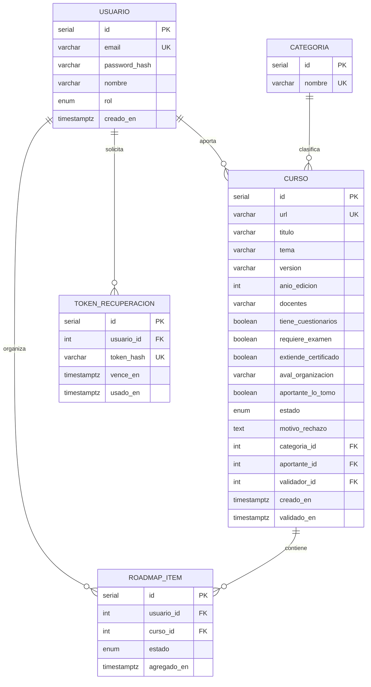
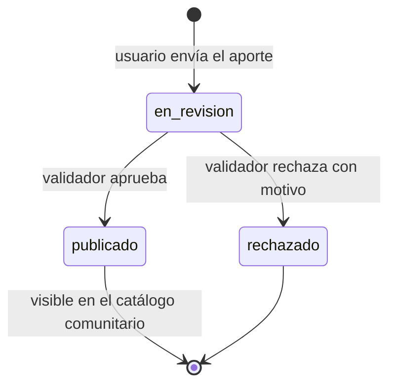

# BackendSchema — Esquema de base de datos y APIs — Brújula

## 1. Modelo de datos

### 1.1 Diagrama entidad-relación



### 1.2 Tablas

#### `usuarios`

| Columna | Tipo | Constraints | Notas |
|---------|------|-------------|-------|
| id | serial | PK | |
| email | varchar(255) | UNIQUE NOT NULL | identificador de login |
| password_hash | varchar(255) | NOT NULL | hash bcrypt; nunca la contraseña en claro |
| nombre | varchar(100) | NOT NULL | |
| rol | enum(rol_usuario) | NOT NULL, default 'usuario' | valores: `usuario`, `validador` |
| creado_en | timestamptz | NOT NULL, default now() | |

**Índices:** el UNIQUE de `email` ya crea el índice usado en el login.

#### `categorias`

| Columna | Tipo | Constraints | Notas |
|---------|------|-------------|-------|
| id | serial | PK | |
| nombre | varchar(80) | UNIQUE NOT NULL | lista cerrada, cargada por seed |

#### `cursos`

| Columna | Tipo | Constraints | Notas |
|---------|------|-------------|-------|
| id | serial | PK | |
| url | varchar(2048) | UNIQUE NOT NULL | enlace web activo; garantiza BR-006 |
| titulo | varchar(200) | NOT NULL | |
| tema | varchar(120) | NOT NULL | |
| version | varchar(50) | NOT NULL | |
| anio_edicion | int | NOT NULL | |
| docentes | varchar(300) | NOT NULL | docentes o disertantes |
| tiene_cuestionarios | boolean | NOT NULL | |
| requiere_examen | boolean | NOT NULL | |
| extiende_certificado | boolean | NOT NULL | |
| aval_organizacion | varchar(200) | NULL | nombre de la organización que lo avala, si hay |
| aportante_lo_tomo | boolean | NOT NULL | declaración de toma (BR-002) |
| estado | enum(estado_curso) | NOT NULL, default 'en_revision' | ver §2 |
| motivo_rechazo | text | NULL | obligatorio si estado = 'rechazado' (BR-009) |
| categoria_id | int | FK → categorias, NOT NULL | |
| aportante_id | int | FK → usuarios, NOT NULL | |
| validador_id | int | FK → usuarios, NULL | quién resolvió el aporte |
| creado_en | timestamptz | NOT NULL, default now() | |
| validado_en | timestamptz | NULL | |

**Índices:** `(estado, categoria_id)` para el listado del catálogo filtrado; `(estado, creado_en)` para la cola de validación.

#### `roadmap_items`

| Columna | Tipo | Constraints | Notas |
|---------|------|-------------|-------|
| id | serial | PK | |
| usuario_id | int | FK → usuarios, NOT NULL | |
| curso_id | int | FK → cursos, NOT NULL | solo cursos publicados |
| estado | enum(estado_roadmap) | NOT NULL, default 'pendiente' | `pendiente`, `en_curso`, `completado` |
| agregado_en | timestamptz | NOT NULL, default now() | |

**Constraint:** `UNIQUE (usuario_id, curso_id)` garantiza BR-008.

#### `tokens_recuperacion`

| Columna | Tipo | Constraints | Notas |
|---------|------|-------------|-------|
| id | serial | PK | |
| usuario_id | int | FK → usuarios, NOT NULL | |
| token_hash | varchar(255) | UNIQUE NOT NULL | se guarda el hash, no el token |
| vence_en | timestamptz | NOT NULL | 30 minutos desde la solicitud |
| usado_en | timestamptz | NULL | un token solo se usa una vez |

## 2. Estados del ciclo de vida del curso



| Estado | Quién lo ve | Qué puede pasar |
|--------|-------------|-----------------|
| en_revision | el aportante y los validadores | un validador aprueba o rechaza |
| publicado | todos | se incluye en roadmaps |
| rechazado | el aportante y los validadores | el aportante ve el motivo |

No hay estado `borrador`: el aporte se envía directo a revisión (la edición está fuera de alcance, PRD §8).

## 3. API REST

**Convención general:**

- Prefijo: `/api/v1`
- Paginación por offset: `?page=1&page_size=20` (máximo `page_size` = 50). Respuesta:
  `{ "items": [...], "total": N, "page": n, "page_size": n }`
- Errores: `{ "error": { "code": "...", "message": "..." } }`
- Timestamps en ISO 8601 UTC
- Sesión: JWT enviado en `Authorization: Bearer <token>`

### 3.1 Autenticación

| Método | Path | Auth | Request | Respuestas |
|--------|------|------|---------|------------|
| POST | `/api/v1/auth/registro` | pública | `{ "email", "password", "nombre" }` | 201 usuario creado · 409 email duplicado · 422 validación |
| POST | `/api/v1/auth/login` | pública, con rate limit | `{ "email", "password" }` | 200 `{ "access_token", "token_type" }` · 401 credenciales · 429 demasiados intentos |
| GET | `/api/v1/auth/me` | sesión | — | 200 datos y rol del usuario · 401 |
| POST | `/api/v1/auth/recuperar` | pública | `{ "email" }` | 202 siempre, exista o no el email |
| POST | `/api/v1/auth/restablecer` | pública | `{ "token", "password" }` | 200 · 400 token inválido, vencido o usado · 422 |

### 3.2 Catálogo de cursos

| Método | Path | Auth | Query / Request | Respuestas |
|--------|------|------|-----------------|------------|
| GET | `/api/v1/cursos` | pública | `page`, `page_size`, `categoria` (id), `q` | 200 paginado, solo `publicado` · 422 |
| GET | `/api/v1/cursos/{id}` | pública | — | 200 · 404 (inexistente o no publicado) |

Ejemplo `GET /api/v1/cursos?page=1&page_size=2` → 200:

```json
{
  "items": [
    { "id": 1, "titulo": "Introducción a SQL", "tema": "Bases de datos",
      "categoria": { "id": 3, "nombre": "Datos" }, "estado": "publicado" }
  ],
  "total": 47,
  "page": 1,
  "page_size": 2
}
```

### 3.3 Aportes y validación

| Método | Path | Auth | Request | Respuestas |
|--------|------|------|---------|------------|
| POST | `/api/v1/aportes` | sesión | todos los campos del curso + `aportante_lo_tomo` | 201 en_revision · 409 URL duplicada · 422 |
| GET | `/api/v1/aportes/mios` | sesión | `page`, `page_size` | 200 paginado, con estado y motivo de rechazo |
| GET | `/api/v1/aportes/pendientes` | validador | `page`, `page_size` | 200 paginado · 403 |
| POST | `/api/v1/aportes/{id}/aprobar` | validador | — | 200 · 403 (incluye aporte propio, BR-007) · 404 · 409 ya resuelto |
| POST | `/api/v1/aportes/{id}/rechazar` | validador | `{ "motivo" }` | 200 · 403 · 404 · 409 · 422 sin motivo |

### 3.4 Roadmap del usuario

| Método | Path | Auth | Request | Respuestas |
|--------|------|------|---------|------------|
| GET | `/api/v1/roadmap` | sesión | `page`, `page_size` | 200 paginado, con estado de cada curso |
| POST | `/api/v1/roadmap/items` | sesión | `{ "curso_id" }` | 201 · 409 ya incluido · 404 curso inexistente o no publicado |
| PATCH | `/api/v1/roadmap/items/{id}` | sesión | `{ "estado" }` | 200 · 404 · 422 estado inválido |
| DELETE | `/api/v1/roadmap/items/{id}` | sesión | — | 204 · 404 |

### 3.5 Categorías

| Método | Path | Auth | Respuestas |
|--------|------|------|------------|
| GET | `/api/v1/categorias` | pública | 200 lista completa (sin paginar: es una lista cerrada y chica) |

## 4. Decisiones del esquema

| Decisión | Alternativas | Por qué |
|----------|--------------|---------|
| Categorías como tabla con FK | Enum de Postgres | Se pueden agregar categorías sin migrar el tipo; el filtro usa el id |
| Roadmap como tabla intermedia con estado | Lista de ids en una columna | Permite estado por curso y el UNIQUE (usuario, curso) |
| Booleanos para cuestionarios, examen y certificado | JSONB de flags | Son tres datos fijos de la SPEC; los booleanos son más simples de filtrar y validar |
| Token de recuperación guardado como hash | Token en claro | Si se filtra la base, los tokens no sirven |
| Un solo campo `estado` con tres valores | Banderas aprobado/rechazado | Evita combinaciones inválidas |       