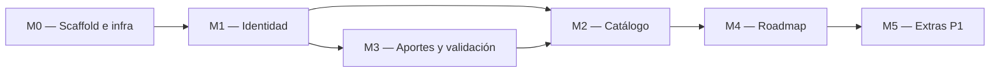

# Implementation Plan — Brújula

## 1. MVP — qué es P0

Criterio de MVP: en una máquina limpia, `docker compose up` y recorrer de punta a punta las
siguientes historias del PRD, sin errores en consola:

- US-001: ver el catálogo paginado y buscar por texto y categoría
- US-002: registrarse e iniciar sesión (con rate limit y bcrypt)
- US-003: aportar un curso
- US-004: validar aportes (aprobar o rechazar)
- US-005: agregar un curso al roadmap
- US-006: ver el roadmap y cambiar el estado de cada curso

Las historias P1 (US-007 recuperación de contraseña, US-008 mis aportes, US-009 detalle de curso)
se hacen en el módulo M5 solo si alcanza el tiempo.

## 2. Módulos y dependencias

Las flechas son dependencias reales: sin scaffold no hay nada que probar; sin sesión no se puede
aportar ni validar; el catálogo necesita cursos publicados, que vienen del seed (M2) o de la
validación (M3); el roadmap necesita cursos publicados.

## 3. Detalle por módulo

### M0 — Scaffold e infraestructura

| # | Tarea | Hecho cuando… | Estimación |
|---|-------|----------------|------------|
| 0.1 | Estructura de carpetas del TRD §3.2 | el árbol existe en el repo, con los directorios por dominio | 30 min |
| 0.2 | `docker-compose.yml` con postgres 18.6 | `docker compose up postgres` levanta y acepta conexiones | 45 min |
| 0.3 | Backend FastAPI mínimo con `GET /health` | `curl localhost:8000/health` responde 200 | 1 h |
| 0.4 | Frontend Vite + React 19 con shell (header con menú sándwich y router) | `pnpm dev` muestra el shell navegable | 1 h |
| 0.5 | Migraciones Alembic con las tablas del BackendSchema §1.2 | las tablas existen al levantar el backend | 1 h |
| 0.6 | Seed: categorías, un usuario validador y cursos publicados de prueba | hay datos al levantar; el README lista las credenciales de prueba | 45 min |

### M1 — Identidad (US-002)

| # | Tarea | Hecho cuando… | Estimación |
|---|-------|----------------|------------|
| 1.1 | `POST /auth/registro` con bcrypt | crea el usuario; un email duplicado responde 409 | 1 h |
| 1.2 | `POST /auth/login` con rate limit | devuelve el token; el sexto intento fallido seguido responde 429 | 1 h 30 min |
| 1.3 | `GET /auth/me` y protección de rutas por token y rol | sin token responde 401; un usuario común en ruta de validador responde 403 | 45 min |
| 1.4 | Pantallas `/registro` y `/login` | se puede registrar e ingresar desde la UI | 1 h 30 min |
| 1.5 | Manejo de sesión en el frontend | las rutas protegidas redirigen a `/login` y vuelven a la ruta original | 1 h |

### M2 — Catálogo (US-001)

| # | Tarea | Hecho cuando… | Estimación |
|---|-------|----------------|------------|
| 2.1 | `GET /categorias` | devuelve la lista completa | 20 min |
| 2.2 | `GET /cursos` paginado con `q` y `categoria` | devuelve solo cursos `publicado`, con `total`, `page` y `page_size` | 1 h 30 min |
| 2.3 | Pantalla `/catalogo` con cards, buscador, filtro y paginador | se busca, se filtra y se pagina desde la UI; muestra skeleton y empty state | 2 h |

### M3 — Aportes y validación (US-003, US-004)

| # | Tarea | Hecho cuando… | Estimación |
|---|-------|----------------|------------|
| 3.1 | `POST /aportes` | crea el curso `en_revision`; una URL repetida responde 409 | 1 h 30 min |
| 3.2 | Pantalla `/aportar` | el formulario envía y muestra errores junto a cada campo | 2 h |
| 3.3 | `GET /aportes/pendientes` paginado | solo el validador lo ve; un usuario común recibe 403 | 45 min |
| 3.4 | `POST /aportes/{id}/aprobar` y `/rechazar` | aprobar publica el curso; rechazar exige motivo (422 si falta); un validador no resuelve su propio aporte (403) | 1 h 30 min |
| 3.5 | Pantalla `/validar` con modal de motivo | el validador aprueba y rechaza desde la UI | 2 h |

### M4 — Roadmap (US-005, US-006)

| # | Tarea | Hecho cuando… | Estimación |
|---|-------|----------------|------------|
| 4.1 | `POST /roadmap/items` | agrega el curso en `pendiente`; repetido responde 409; no publicado responde 404 | 1 h |
| 4.2 | `GET /roadmap` paginado | devuelve solo los cursos del usuario con su estado | 45 min |
| 4.3 | `PATCH` y `DELETE /roadmap/items/{id}` | cambia el estado o quita el curso; el de otro usuario responde 404 | 1 h |
| 4.4 | Pantalla `/roadmap` y botón "Agregar a mi roadmap" en el catálogo | se agrega, se cambia el estado y se quita desde la UI | 2 h |

### M5 — Extras P1 (solo si alcanza el tiempo)

| # | Tarea | Hecho cuando… | Estimación |
|---|-------|----------------|------------|
| 5.1 | `GET /cursos/{id}` y pantalla `/catalogo/:id` (US-009) | muestra el detalle de un curso publicado; uno inexistente responde 404 | 1 h 30 min |
| 5.2 | `GET /aportes/mios` y pantalla `/mis-aportes` (US-008) | el usuario ve el estado y el motivo de rechazo de sus aportes | 1 h 30 min |
| 5.3 | `POST /auth/recuperar` y `/restablecer` con sus pantallas (US-007) | el ciclo completo funciona; el enlace se imprime en los logs del backend | 2 h 30 min |

## 4. Ejecución (Instancia B)

Regla: 1 tarea (o lote coherente) = una rama según el flujo de `docs/GIT_WORKFLOW.md` más
commits convencionales. Esta tabla se actualiza mientras se avanza.

| # | Tarea | Módulo | Estado | Rama / Commit |
|---|-------|--------|--------|---------------|
| 0.1 | Estructura de carpetas | M0 | [ ] | |
| 0.2 | docker-compose postgres | M0 | [ ] | |
| 0.3 | Backend mínimo con /health | M0 | [ ] | |
| 0.4 | Frontend con shell | M0 | [ ] | |
| 0.5 | Migraciones Alembic | M0 | [ ] | |
| 0.6 | Seed de datos | M0 | [ ] | |
| 1.1 | Registro | M1 | [ ] | |
| 1.2 | Login con rate limit | M1 | [ ] | |
| 1.3 | Sesión y roles en la API | M1 | [ ] | |
| 1.4 | Pantallas de registro y login | M1 | [ ] | |
| 1.5 | Sesión en el frontend | M1 | [ ] | |
| 2.1 | Categorías | M2 | [ ] | |
| 2.2 | Listado de cursos | M2 | [ ] | |
| 2.3 | Pantalla de catálogo | M2 | [ ] | |
| 3.1 | Alta de aportes | M3 | [ ] | |
| 3.2 | Pantalla de aportar | M3 | [ ] | |
| 3.3 | Aportes pendientes | M3 | [ ] | |
| 3.4 | Aprobar y rechazar | M3 | [ ] | |
| 3.5 | Pantalla de validación | M3 | [ ] | |
| 4.1 | Agregar al roadmap | M4 | [ ] | |
| 4.2 | Listar roadmap | M4 | [ ] | |
| 4.3 | Cambiar estado y quitar | M4 | [ ] | |
| 4.4 | Pantalla de roadmap | M4 | [ ] | |
| 5.1 | Detalle de curso | M5 | [ ] | |
| 5.2 | Mis aportes | M5 | [ ] | |
| 5.3 | Recuperación de contraseña | M5 | [ ] | |

## 5. Estrategia de testing

Se planifica acá y se implementa en la clase del 27/10.

- **Unit tests (services):** funciones puras de negocio: BR-007 (no validar lo propio), BR-009 (rechazo con motivo), transiciones de estado del curso y reglas del roadmap. Patrón AAA, sin BD ni HTTP.
- **Integration tests:** endpoints contra el Postgres del compose: registro, login con rate limit, aporte duplicado (409), aprobar y rechazar, roadmap duplicado (409).
- **Frontend:** hooks con Vitest (estados de carga, paginación y errores).
- **Objetivo de cobertura:** al menos 80% en los services.

## 6. Riesgos del plan

| Riesgo | Impacto | Mitigación |
|--------|---------|------------|
| El formulario de aporte tiene muchos campos y su validación lleva más de lo estimado | medio | un único esquema de validación en el backend y mensajes de error uniformes |
| El MVP P0 son 6 historias y poco tiempo (hasta el lunes 26/10, 22:00) | alto | M5 queda como opcional; se prioriza que M0 a M4 funcionen de punta a punta |
| Docker Compose no levanta en una máquina limpia | alto | probar `git clone` más `docker compose up` en una carpeta nueva antes de entregar |
| El seed no deja un validador de prueba y no se puede probar la validación | medio | tarea 0.6 incluye el validador y documenta sus credenciales en el README |